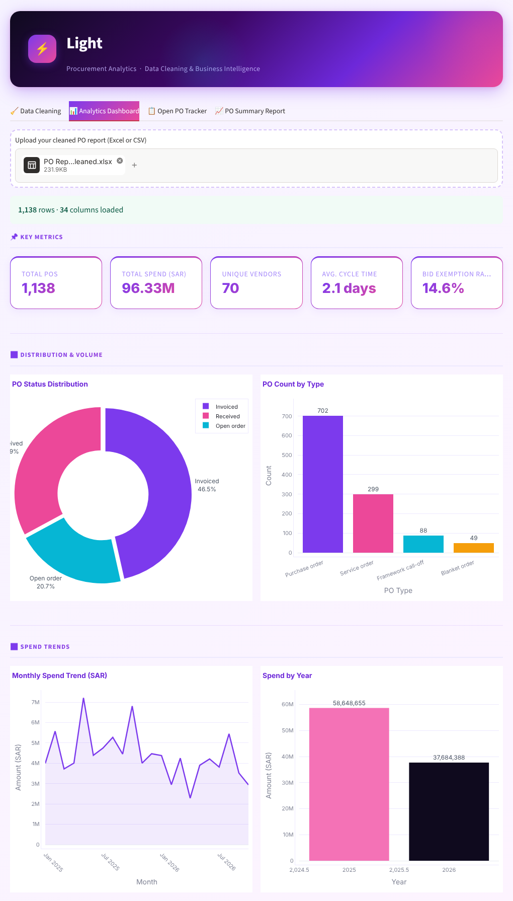
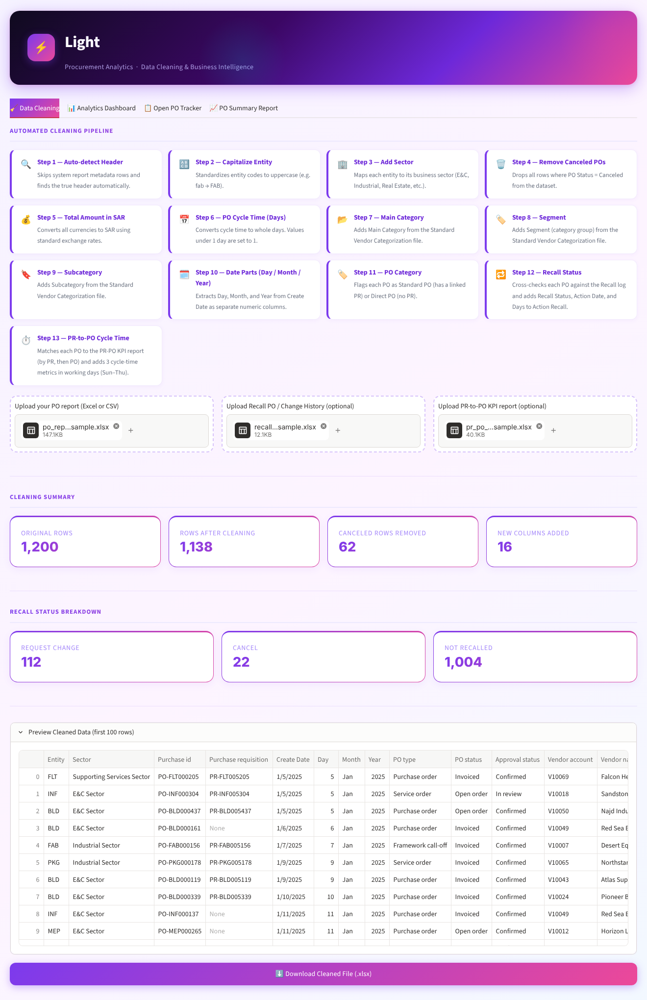
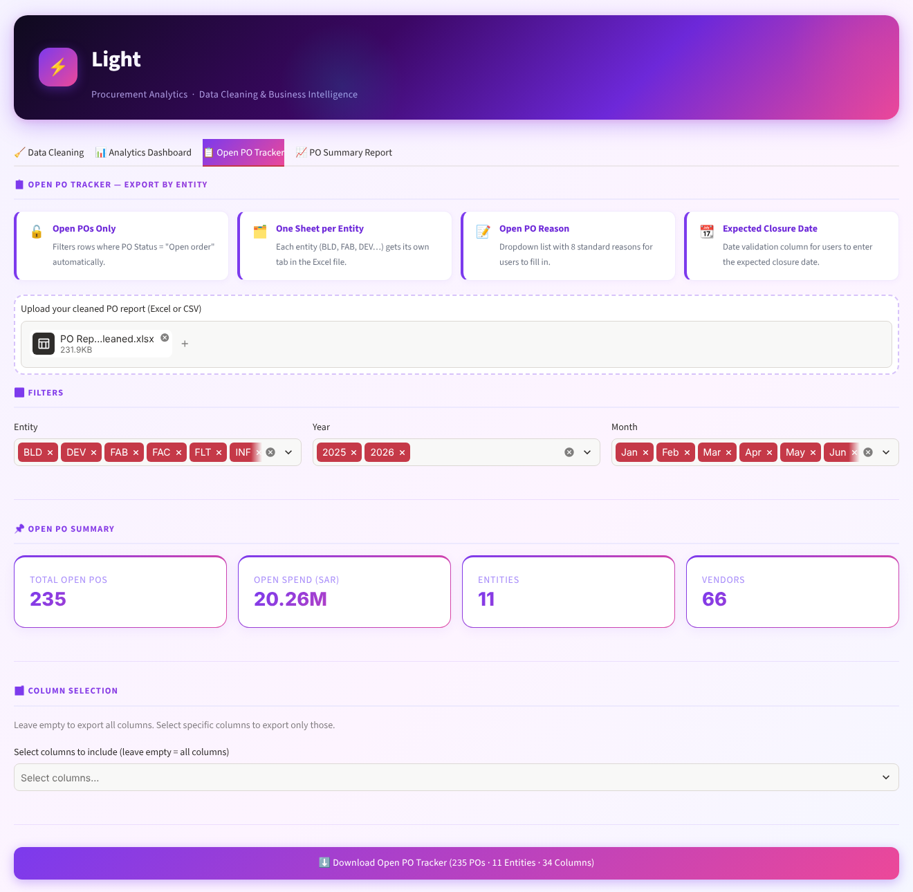
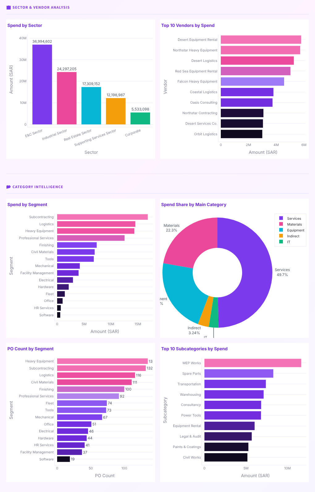

<p align="center">
  
</p>

<h1 align="center">⚡ Light – Procurement Analytics</h1>

<p align="center">
  Turn raw ERP purchase-order exports into clean data, an interactive spend dashboard,<br>
  and ready-to-send Excel reports in minutes instead of hours.
</p>

<p align="center">
  
  
  
  
  
  
</p>

> **All data in this repository is synthetic.** Companies, vendors, people and amounts are fictional and were generated by [`scripts/generate_sample_data.py`](scripts/generate_sample_data.py).

---

## The problem

In a multi-entity group, the procurement team pulls a PO report from the ERP every week and then spends hours making it usable. The headers are buried under title rows, entity codes come in mixed case, amounts are in several currencies, cycle times are free text ("2 Days 5 Hours"), payment terms are written twenty different ways, and canceled POs inflate the spend. After all that, someone still has to build the open-PO follow-up file for each entity and the monthly management summary.

**Light automates that whole loop.** You upload the raw export and get back a clean dataset, a live dashboard, and two formatted Excel deliverables.

## What it does

| Tab | Input | Output |
|---|---|---|
| 🧹 **Data Cleaning** | Raw PO report (+ optional change-history log and PR-to-PO KPI report) | Cleaned Excel file with **up to 16 new columns** |
| 📊 **Analytics Dashboard** | Cleaned report | 5 KPI cards, 14 interactive charts, 9 sidebar filters (entity, sector, status, category, year, month, date range…) |
| 📋 **Open PO Tracker** | Cleaned report | Excel workbook with **one sheet per entity**, dropdowns for *Open PO Reason* and *Expected Closure Date* that buyers fill in |
| 📈 **PO Summary Report** | Cleaned report | Executive workbook: sector overview per year, status analysis, one sheet per **Entity × Year**, full data appendix |

### The cleaning pipeline (13 steps)

1. **Auto-detect the header row.** Skips ERP title/metadata rows.
2. **Standardise entity codes** (`fab` → `FAB`).
3. **Map entity to sector** (configurable).
4. **Remove canceled POs.**
5. **Convert all currencies to SAR** (case-insensitive currency codes).
6. **Parse cycle-time text into whole days** (`"1 Days 7 Hours"` → `1`, under a day → `1`).
7. **–9. Enrich from the vendor category master:** Main Category → Segment → Subcategory.
10. **Split Create Date** into Day / Month / Year.
11. **Classify PO Category:** *Standard PO* (has a PR) vs *Direct PO* (no PR). This is a compliance signal.
12. **Recall status** from the change-history log: latest action per PO, plus the **business days** from creation to recall.
13. **PR-to-PO cycle times** from the KPI report, recomputed in **working days (Sun–Thu)**. Matching uses the PR number first, then falls back to the PO number.

Payment terms are also normalised (`"Due 30 Days"`, `"30 days after invoice date "` → `Credit 30`). Unknown text is kept as-is, so new variants surface instead of being silently dropped.

## Screenshots

| Data cleaning | Open PO tracker |
|---|---|
|  |  |

<p align="center"></p>

## Quick start

```bash
git clone https://github.com/AbdulrahmanSalem1998/light-procurement-analytics.git
cd light-procurement-analytics
python -m venv .venv && source .venv/bin/activate   # Windows: .venv\Scripts\activate
pip install -r requirements.txt
streamlit run app.py
```

Then try it with the files in [`sample_data/`](sample_data):

1. **Data Cleaning:** upload `po_report_sample.xlsx`, plus optionally `recall_log_sample.xlsx` and `pr_po_kpi_sample.xlsx`, then download the cleaned file.
2. Upload that cleaned file to the **Dashboard**, **Open PO Tracker** or **Summary Report** tabs.

## Project structure

```
├── app.py                         # Streamlit UI (4 tabs)
├── light/
│   ├── config.py                  # ⚙️  entity→sector map, FX rates, payment terms, file paths
│   ├── pipeline.py                # cleaning logic: pure pandas, no Streamlit, unit-tested
│   ├── reports.py                 # openpyxl Excel builders (tracker + executive summary)
│   └── theme.py                   # colours, CSS, Plotly chart style
├── data/
│   └── vendor_categorization_sample.xlsx   # category master (Code → Main/Segment/Sub)
├── sample_data/                   # synthetic ERP exports to try the app
├── scripts/generate_sample_data.py
├── tests/test_pipeline.py         # pytest suite (parsers, pipeline, end-to-end)
└── docs/screenshots/
```

The business logic in `light/pipeline.py` has no Streamlit dependency, so the same cleaning can run from a notebook, a scheduled job or a Power BI Python step.

## Adapting it to your organisation

Everything company-specific lives in [`light/config.py`](light/config.py):

```python
SECTOR_MAP = {"NWH": "Corporate", "BLD": "E&C Sector", ...}   # your entity codes
FX_TO_SAR  = {"USD": 3.75, "EUR": 4.08, ...}                   # your reference rates
PAYMENT_TERM_MAP = {"due 30 days": "Credit 30", ...}           # your raw → standard terms
CATEGORY_FILE = ROOT_DIR / "data" / "vendor_categorization_sample.xlsx"
```

<details>
<summary><b>Expected input columns</b> (matching is case-insensitive where noted)</summary>

| Column | Used for |
|---|---|
| `Entity` | Sector mapping, per-entity sheets (also the header auto-detect marker) |
| `Purchase id` / `PO number` / `PO #` … | Matching to recall + KPI logs |
| `Purchase requisition` / `PR number` … | PO Category, KPI matching |
| `Create Date` | Date parts, trends, recall business days |
| `PO status` | Cancel removal, open-PO filter |
| `Approval status`, `PO type`, `Vendor name` | Dashboard + summary breakdowns |
| `Buyer Group`, `Buyer Group Name` | Category enrichment |
| `Payment terms` | Standardised payment term |
| `Currency`, `Total amount` | SAR conversion |
| `PO Cycle Time` | Cycle-time days |
| `Bid exemption` (0/1) | Bid exemption rate |
| `VAT number`, `CR number` | Kept as text (no scientific notation) |

Missing optional columns are skipped. The pipeline adapts to what is present.
</details>

## Tests

```bash
pytest
```

The suite covers the text parsers, payment-term normalisation, the Sun–Thu business-day logic, header auto-detection, the full cleaning pipeline, and an end-to-end run on the sample files.

## Tech stack

**Python · pandas · NumPy · Streamlit · Plotly · openpyxl · pytest**

## Author

**Abdulrahman Saud**, Corporate Supply Chain Analyst · B.Sc. Data Science · Microsoft PL-300<br>
[LinkedIn](https://www.linkedin.com/in/abdulrahman-saud-a918a6344)

## License

[MIT](LICENSE)
